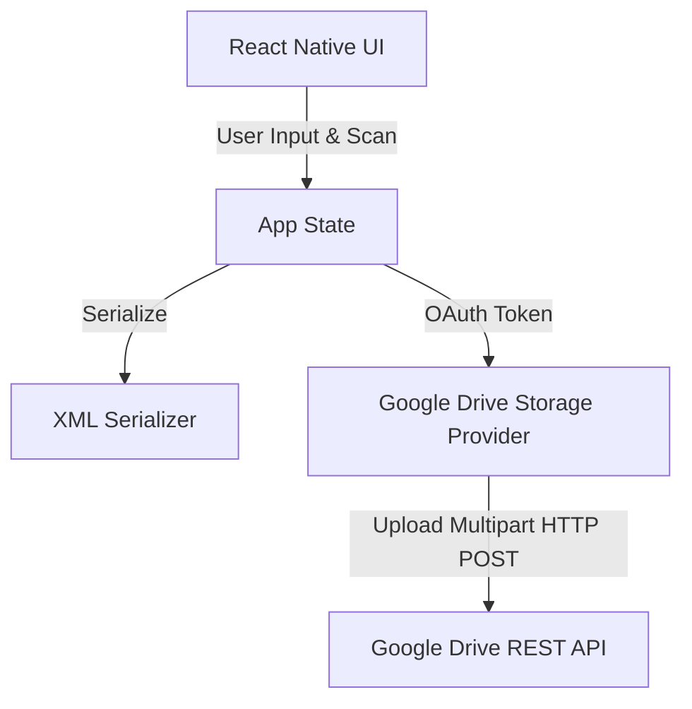

# Product Requirements Document (PRD) - QR Scanner to Google Drive (XML)

## 1. Executive Summary

* **Problem Statement**: Users need a simple and reliable way to input a custom number reference, scan a physical QR code target, and immediately save these paired values as formatted records to a specific Google Drive directory without manual file-creation or layout manipulation.
* **Proposed Solution**: A single-screen Expo / React Native mobile application that captures a numeric input, scans a barcode using `expo-camera`, verifies the values, and publishes the record formatted as an XML file into a dedicated Google Drive folder via browser-based Google OAuth.
* **Success Criteria**:
  * **Zero Data Loss**: 100% of initiated file uploads must either succeed completely or show an actionable error state to the user.
  * **Low Latency Scan-to-Display**: Captured QR code data must render on the display card within 100ms of barcode detection.
  * **Secure Scoped Access**: The application must request only the minimum required OAuth scope (`drive.file`) to write data, protecting user privacy.
  * **Accurate XML Schema**: Serialized output must strictly match the agreed Option A XML structure.

---

## 2. User Experience & Functionality

### User Personas
* **Operations Operator**: A user performing high-volume inventory verification, checking item reference numbers, scanning barcodes, and needing fast, single-tap submission to Google Drive.

### User Stories & Acceptance Criteria

#### Story 1: Google Authentication
* **As an** operator, **I want to** authenticate using my Google Account directly in the app, **so that** I can write scan logs directly into my personal/workspace Google Drive.
* **Acceptance Criteria**:
  * Persistent sign-in state across app launches.
  * Easy-to-find Sign In and Sign Out action items in the top header.
  * Utilizes secure, browser-based Google Sign-In prompts inside an in-app browser modal on iOS and Android.

#### Story 2: Reference Number Entry
* **As an** operator, **I want to** enter a reference number, **so that** I can associate it with the physical QR code I am about to scan.
* **Acceptance Criteria**:
  * Input is limited to numeric characters.
  * Input field highlights clearly when active.
  * Input remains editable until a scan is completed or saved.

#### Story 3: Barcode Scanning
* **As an** operator, **I want to** scan a QR code using my phone's camera, **so that** the app automatically extracts its string contents.
* **Acceptance Criteria**:
  * The camera view is rendered within a clean, bounded alignment overlay.
  * Scanner is active only after camera permissions are granted.
  * Once a scan succeeds, scanning is temporarily paused to prevent duplicate capture until reset or saved.

#### Story 4: Upload and Sync
* **As an** operator, **I want to** tap a single button to save the combined data to Google Drive, **so that** the XML record is securely stored.
* **Acceptance Criteria**:
  * XML file is saved under the path `QRScannerGDrive/Scan_[InputNumber]_[Timestamp].xml`.
  * If the `QRScannerGDrive` folder doesn't exist, the app creates it first.
  * Button shows a loading indicator during the API call.
  * Immediate error alert pops up if uploading fails (e.g. no internet connection).

### Non-Goals
* Local database storage of historical scans.
* Offline background sync queueing (any failed scan must be retried manually by the user).
* Multi-user shared folder selection picker (always write to a fixed app folder name).

---

## 3. Technical Specifications

### Architecture Overview
The application consists of a single React Native page running under Expo Router, executing within the React Native runtime.

### Integration Points
* **OAuth 2.0 Identity Provider**: Google Identity APIs via `react-native-nitro-google-signin` (utilizing Android Credential Manager and native iOS/Android SDKs).
* **Storage Target**: Google Drive v3 REST API (`https://www.googleapis.com/upload/drive/v3/files`).
* **Hardware Interop**: iOS and Android camera subsystems via `expo-camera`.

### Security & Privacy
* **Access Scope**: Scoped strictly to `https://www.googleapis.com/auth/drive.file`. The app can only see and write files that it created.
* **Secure Token Handling**: Access tokens are kept in-memory and authenticated dynamically; no long-lived raw secrets are checked into the source repository.

---

## 4. Risks & Roadmap

### Phased Rollout
* **Phase 1 (MVP)**:
  * Native Google Sign-In integration.
  * Native Stack layout with single-screen view.
  * Working QR scanner, numeric input, and XML serialization.
  * File uploads directly to Google Drive folder.
* **Phase 2 (UX Polish)**:
  * Styled feedback animations (success, error, and loader overlays).
  * Auto-focus on numeric field on start.
  * Detailed diagnostic reporting for Google connection issues.

### Technical Risks
* **Google Console Credentials Mismatch**: OAuth flows require client IDs, redirect schemes, and authorized redirect URIs to align perfectly with the Google Cloud Console. 
  * *Mitigation*: Detailed setup documentation in README, using `.env` variables for the Google Web Client ID.
* **Network Interruptions**: Unstable cellular connections when submitting.
  * *Mitigation*: Explicit, clear error toasts and retry action triggers.
